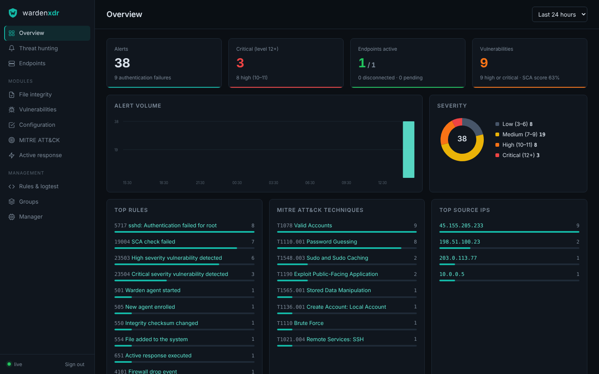
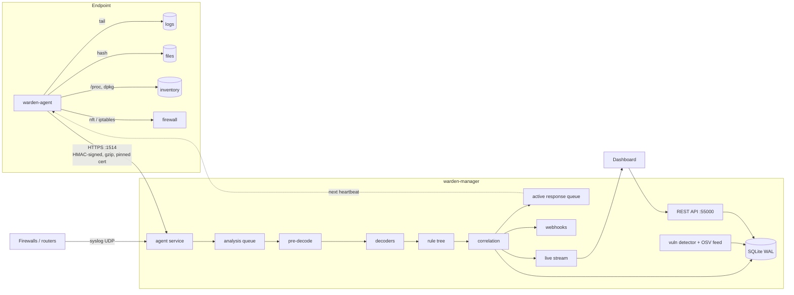
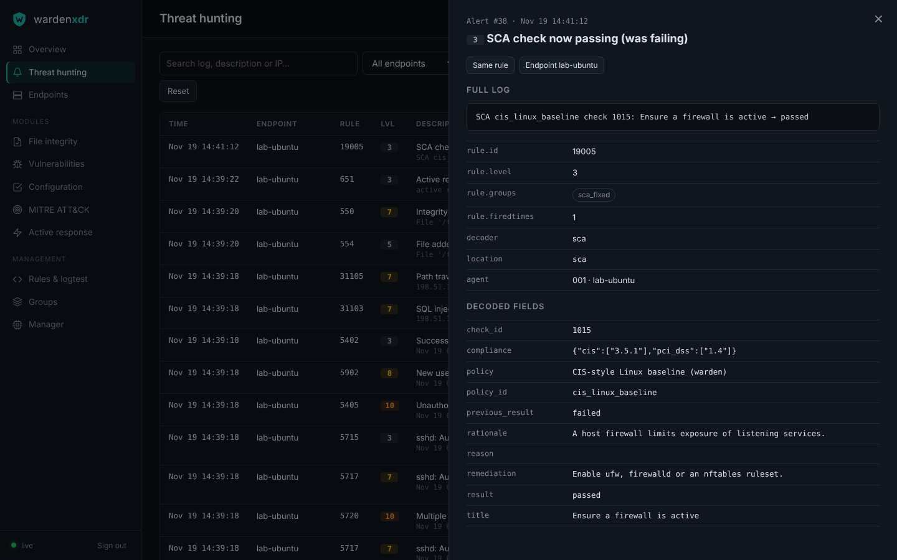
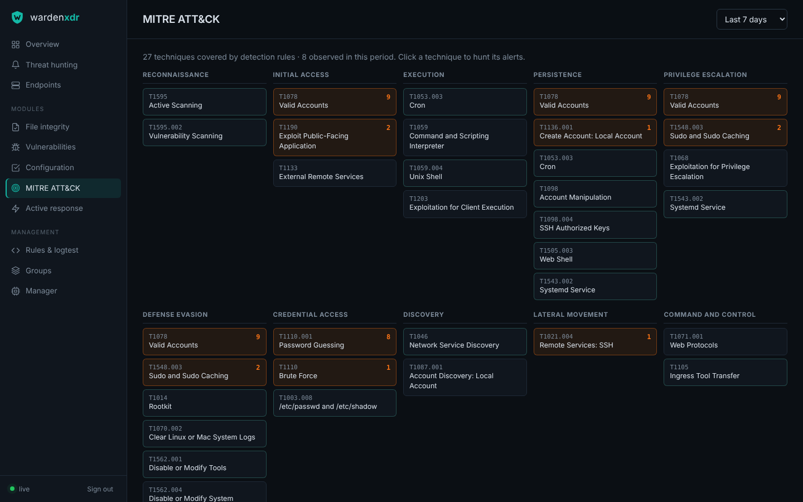
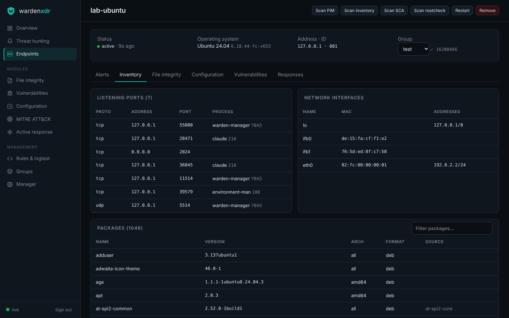

<div align="center">

# warden-xdr

**A lightweight, open-source XDR + SIEM platform, built from scratch in Go.**
An endpoint agent, an analysis manager and a SOC dashboard in two small binaries, inspired by the architecture of [Wazuh](https://wazuh.com).

`agent ≈ 7 MB static binary` · `manager ≈ 16 MB, single SQLite file` · `no JVM, no Elasticsearch, no external services`

</div>



---

## What it does

| Module | What you get | Wazuh equivalent |
|---|---|---|
| **Log analysis** | Tails syslog, auth, web, auditd, kernel, Suricata EVE JSON; syslog receiver for agentless devices | logcollector + analysisd |
| **Decoders & rules** | YAML decoders (regex, named fields) and a rule *tree* (`if_sid`, `if_group`) with levels, groups, MITRE ATT&CK and compliance tags (PCI DSS, GDPR, NIST 800-53, CIS) | ruleset |
| **Correlation** | Frequency rules (`if_matched_sid` / `if_matched_group`, `frequency`, `timeframe`, `same_field`, `ignore`) for brute force, scans, attack bursts | composite rules |
| **File integrity monitoring** | SHA-256 + size/mode/owner baselines, added/modified/deleted with changed-attribute diff, critical-path escalation (`/etc/shadow`, `authorized_keys`, cron, systemd units, binaries) | syscheck |
| **Inventory** | OS, packages (dpkg / rpm / apk), listening ports with owning process, processes, interfaces | syscollector |
| **Vulnerability detection** | Matches installed packages against [OSV](https://osv.dev) advisories (Debian, Ubuntu, Alpine, Rocky, Alma) with dpkg-correct version comparison and CVSS v3 scoring | vulnerability-detector |
| **Configuration assessment** | CIS-style policies with **Wazuh-compatible SCA rule syntax** (`f:`, `d:`, `c:`, `p:`, `r:`, `n: … compare`, `not`) and pass/fail change alerts | SCA |
| **Rootcheck** | Hidden-process detection (kill(0) vs /proc), rootkit artefacts, promiscuous interfaces, SUID files in temp dirs, world-writable `/etc` | rootcheck |
| **Command monitoring** | Run commands on an interval and alert when their output changes (e.g. new listening port) | command monitoring |
| **Active response** | Rules trigger `firewall-drop` (nftables/iptables), `host-deny`, `kill-process`, `disable-account`, with automatic revert after a timeout; also manual from the dashboard | active-response |
| **Central management** | Agent groups with pushed YAML config (hash-checked, applied live), remote scans, restart | agent groups / shared config |
| **Dashboard & API** | Overview, threat hunting with live stream, endpoint inventory, FIM, vulnerabilities, SCA, MITRE ATT&CK matrix, active response, rule browser + **logtest**, group editor | Wazuh dashboard + API |
| **Integrations** | Webhooks (JSON or Slack) per minimum level | integrator |

## Architecture



**Agent ↔ manager protocol**

1. **Enrollment:** `POST /v1/enroll` with the shared enrollment password. The manager issues an agent ID and a 256-bit key. The agent pins the manager's TLS certificate fingerprint (configured, or trust on first use).
2. **Every later request** carries `X-Warden-Agent`, `X-Warden-Timestamp` and `X-Warden-Signature = HMAC-SHA256(key, id ∥ ts ∥ method ∥ path ∥ sha256(body))`. Requests outside a ±5 minute window are rejected. Bodies are gzip-compressed.
3. **Heartbeat:** `POST /v1/control` every 10s. The reply carries queued commands (active response, scans) and the current group-config hash. On a hash change the agent pulls `/v1/config` and applies it without restarting.
4. **Events:** batched (≤500 or 1s) to `/v1/events`. A failed batch is kept and retried with backoff. A bounded buffer protects the host from floods.

## Quick start

### Option A: Docker Compose (manager + a Debian demo endpoint)

```bash
WARDEN_ENROLLMENT_PASSWORD=change-me WARDEN_ADMIN_PASSWORD='S3cure!pass' docker compose up -d --build
# Dashboard: https://localhost:55000  (admin / S3cure!pass, self-signed cert)
docker compose exec -T demo-agent bash -s < scripts/simulate-attacks.sh   # generate attack telemetry
ssh -p 2222 root@localhost                                                # or attack it for real
```

### Option B: binaries

Requirements: Go 1.24+ and a C compiler (the manager uses SQLite through cgo; the agent is pure Go).

```bash
make build                         # bin/warden-manager, bin/warden-agent
./bin/warden-manager -c deploy/manager.yml
#  → prints the cert fingerprint; admin + enrollment passwords are written to data/*.txt

sudo WARDEN_MANAGER=127.0.0.1:1514 \
     WARDEN_ENROLLMENT_PASSWORD=$(cat data/enrollment-password.txt) \
     ./bin/warden-agent
```

Open `https://localhost:55000` and sign in as `admin` with the password from `data/admin-password.txt`.

### Option C: Render (one click from this repo)

The manager can run on a PaaS that gives you a single HTTPS port. Set these environment variables on a Docker web service built from `deploy/Dockerfile.manager`:

| Variable | Value |
|---|---|
| `WARDEN_SINGLE_PORT` | `:10000` (agents and dashboard share one port) |
| `WARDEN_TLS` | `off` (Render terminates TLS) |
| `WARDEN_SYSLOG` | `off` (no UDP on Render) |
| `WARDEN_ADMIN_PASSWORD`, `WARDEN_ENROLLMENT_PASSWORD` | your secrets |

Agents then connect with `WARDEN_MANAGER=<service>.onrender.com:443` and `WARDEN_MANAGER_TLS=system`, which verifies Render's public certificate instead of pinning it. Without a persistent disk the database resets on each deploy; agents re-enroll automatically, but alert history is lost. Attach a disk at `/var/lib/warden` to keep it.

### Installing agents on servers

```bash
make agents     # dist/warden-agent-{linux,darwin,windows}-{amd64,arm64,...}
sudo install -m 0755 dist/warden-agent-linux-amd64 /usr/local/bin/warden-agent
sudo install -D -m 0600 deploy/agent.yml /etc/warden-agent/agent.yml   # set manager + password + fingerprint
sudo install -m 0644 deploy/warden-agent.service /etc/systemd/system/
sudo systemctl enable --now warden-agent
```

The dashboard's **Endpoints → Deploy new agent** shows the exact command, with your manager's certificate fingerprint filled in.

## Screenshots

| Threat hunting | MITRE ATT&CK | Endpoint inventory |
|---|---|---|
|  |  |  |

## Writing detections

Decoders (`ruleset/decoders/*.yml`) extract fields:

```yaml
- name: sshd
  program: ^sshd$
  regex:
    - '^(?P<action>Failed|Accepted) (?P<auth_method>\S+) for (?:invalid user )?(?P<dstuser>\S+) from (?P<srcip>[0-9a-fA-F.:]+) port (?P<srcport>\d+)'
```

Rules (`ruleset/rules/*.yml`) form a tree. The deepest matching child wins, then frequency rules can escalate it:

```yaml
- id: 5716
  if_sid: [5700]
  level: 5
  field: {action: '^Failed$'}
  description: 'sshd: Authentication failed'
  groups: [authentication_failed]
  mitre: [T1110.001]

- id: 5720
  level: 10
  if_matched_group: authentication_failed
  frequency: 8
  timeframe: 120
  same_field: [srcip]
  description: Multiple authentication failures from the same source
  mitre: [T1110]
  active_response: {command: firewall-drop, timeout: 600, field: srcip}
```

Test rules without touching data in **Rules & logtest** (or `POST /api/logtest`). Hot-reload with **Reload ruleset**.

Rule conditions: `type`, `decoded_as`, `program`, `location`, `match`, `not_match`, `field` (map of regexes), `if_sid`, `if_group`. Correlation: `if_matched_sid`, `if_matched_group`, `frequency`, `timeframe`, `same_field`, `ignore`.

## Vulnerability feed

The repo ships a small offline demo feed (`feeds/demo-feed.json`). For real coverage, sync OSV:

```bash
./bin/warden-manager feed-osv -c deploy/manager.yml Debian:12 Ubuntu:22.04:LTS Ubuntu:24.04:LTS
# or: set vulnerability_detector.osv_auto_sync: true to sync every ecosystem your agents run
# or: the "Sync OSV feed" button on the Vulnerabilities page
```

## REST API

All endpoints except `/api/health` and `/api/login` need `Authorization: Bearer <token>`.

| Method | Path | Purpose |
|---|---|---|
| POST | `/api/login` | `{username,password}` → `{token}` (12h session) |
| GET | `/api/overview?hours=24` | KPIs, timeline, top rules/agents/IPs, MITRE counts |
| GET | `/api/alerts?agent=&level=&rule=&group=&mitre=&q=&hours=&limit=&offset=` | Threat hunting |
| GET | `/api/alerts/stream?token=` | Server-sent events, live alerts |
| GET/DELETE | `/api/agents[/{id}]` | Endpoints |
| PUT | `/api/agents/{id}/group` | Move an agent to another group |
| GET | `/api/agents/{id}/inventory` | Packages, ports, processes, interfaces |
| POST | `/api/agents/{id}/commands` | `{name,args:{target},timeout}`: active response or scan |
| GET | `/api/fim`, `/api/sca`, `/api/vulns`, `/api/commands` | Module data |
| POST | `/api/vulns/sync` | Sync OSV and rescan all agents |
| GET/POST | `/api/rules`, `/api/rules/reload`, `/api/logtest` | Ruleset |
| GET/PUT | `/api/groups[/{name}]` | Centralised agent config |
| GET | `/api/mitre`, `/api/manager` | ATT&CK coverage, manager status |

## Security model

- **TLS everywhere:** a self-signed ECDSA P-256 certificate is created on first start, or you supply your own. Agents pin the SHA-256 fingerprint.
- **Per-agent keys:** HMAC-SHA256 request signing with timestamp skew checks. Deleting an agent revokes it immediately.
- **No shell in active response:** targets are validated (`net.ParseIP`, PID, username regex) and passed to `exec` as arguments, so a crafted log line can't inject a command. Whitelisted IPs and loopback are never blocked.
- **Dashboard:** PBKDF2-SHA256 (210k iterations) password hashes, constant-time comparisons, throttled failures, strict CSP, and all log content HTML-escaped.
- **Secrets** are generated on first start into `data/` with mode 0600, or set through `WARDEN_ADMIN_PASSWORD` / `WARDEN_ENROLLMENT_PASSWORD`.

## Project layout

```
cmd/warden-manager      manager entrypoint + CLI (passwd, feed-osv, feed-json)
cmd/warden-agent        agent entrypoint
internal/proto          wire protocol, request signing
internal/agent          enrollment, transport, logcollector, FIM, inventory, SCA, rootcheck, active response
internal/manager/engine pre-decoding, decoders, rule tree, correlation, MITRE map
internal/manager/store  SQLite state (agents, alerts, FIM, inventory, SCA, vulns, commands)
internal/manager/vuln   OSV sync, dpkg version comparison, CVSS v3
internal/manager/server agent API, analysis pipeline, REST API, syslog, webhooks
web/static              dashboard (vanilla JS, embedded into the manager binary)
ruleset/                decoders, rules, SCA policies, group configs
deploy/                 Dockerfiles, systemd units, sample configs
scripts/                attack simulator
```

## Testing

```bash
make test     # unit tests: rule engine & correlation, SCA rule syntax, version comparison, CVSS
```

The full pipeline has been checked end to end against a live agent: enrollment and certificate pinning, an SSH brute force that ends in a real nftables block, web attacks, sudo abuse, backdoor accounts, FIM changes, SCA, vulnerability matching and syslog ingestion.

## Honest scope vs. Wazuh

Wazuh is a decade of work by a large team. This project reproduces its **architecture and core detection loop**, not all of it. Not implemented yet:

- Windows Event Log / macOS unified log collection (the agent cross-compiles and FIM works there; log collection is Linux-first)
- Real-time FIM (inotify/eBPF). FIM is interval-based.
- Manager clustering and an OpenSearch backend (SQLite handles a lab or SMB fleet; see the roadmap)
- Cloud modules (AWS/GCP/Azure, Office 365, GitHub audit logs), Docker listener, osquery
- CDB lists, the full XML ruleset and decoder syntax, and the full MITRE catalogue
- RBAC and multi-user management in the dashboard

## Roadmap

- [ ] eBPF/inotify real-time FIM and process-exec telemetry
- [ ] Windows Event Log collector and a Sysmon decoder pack
- [ ] Pluggable storage backend (OpenSearch / ClickHouse) for large fleets
- [ ] Sigma rule importer
- [ ] RBAC, API tokens, audit log
- [ ] Threat-intel enrichment (AbuseIPDB, MISP) and CDB-style lists

## License

MIT. See [LICENSE](LICENSE).
